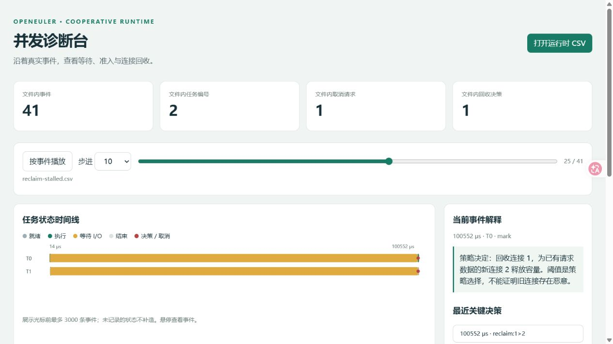
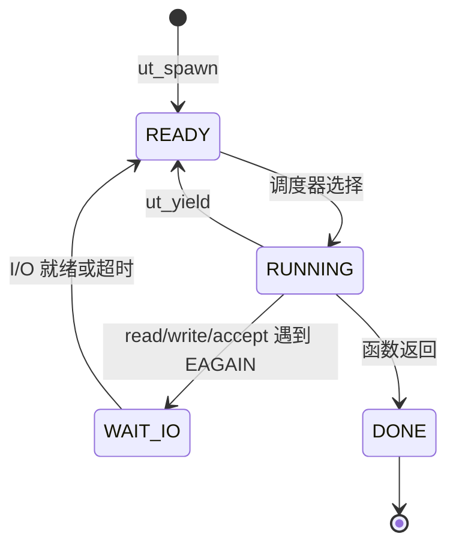

# openEuler 用户级并发运行时与请求进展感知的慢连接隔离

一个可在 openEuler 中构建、运行的 C 系统原型，研究慢连接占满有限并发容量时，如何按可解释策略接收新请求、取消等待并回收资源。保留调度与 I/O 教学演示，并提供 TCP 服务和本地并发诊断台。

2026-11-17：新增有界请求协议服务。完整请求、请求阶段期限和独立探测任务替代“收到过字节就算进展”的判断，支持同一运行时、同一资源预算下的三种策略切换。原 echo 示例继续保留，历史性能数据不用于证明新服务的收益。

2026-11-15：已加入两种可切换的准入策略、带代次校验的协作取消、栈保护页和轨迹诊断界面。特色是把资源控制决策与实际执行轨迹连起来；不主张发明协程，也不宣称生产可用、通用加速或获奖保证。



图中数据来自 CI 的功能用例，不是性能测量。界面支持本地导入 CSV、按事件播放、任务筛选和决策定位，见 [诊断台](tools/trace_viewer.html)。GitHub 不执行 HTML，需下载整个仓库或 ZIP 后打开该文件。

参赛准备见 [推进清单](docs/COMPETITION_PLAN.md)。另有历史 [socket 场景及生命周期验证](docs/SERVICE_VALIDATION.md)，运行 `make service-check`。

**先确认你要看什么：本仓库是用户级线程专题项目；全部 24 项课程作业另有独立实验包。** 课程包的基础任务、拓展验收和开源贡献状态见 [课程实验入口](docs/COURSE_STATUS.md)。

## 版本与入口

本页说明包含 TCP 准入策略、协作取消、栈保护和并发诊断台的机制版本。已有旧克隆请先保留个人改动并更新代码；历史提交与历史性能数据仍保留，不把旧测量当作新策略的性能结论。

| 内容 | 入口 |
| --- | --- |
| 当前运行时、TCP 服务与诊断工具 | 以下快速开始；[接口](include/uthread.h)、[实现](src/uthread.c)、[TCP 服务](examples/tcp_echo.c) |
| 早期调度、等待与优化数据 | [第二阶段](docs/STAGE2.md)、[运行时优化](docs/OPTIMIZATION.md)、[等待表优化](docs/WAIT_OPTIMIZATION.md)；均按各自记录版本解读 |
| 独立的 24 项课程实验包 | [课程实验入口](docs/COURSE_STATUS.md)，不包含在本仓库的克隆中 |

建议队友先运行基本演示，再阅读接口与 TCP 策略。开发分支为 `perf/runtime-overhead`，默认分支作为整合入口；协作修改请使用个人分支与 PR。

## 快速开始

已验证的环境是 openEuler 24.03 LTS-SP3 x86_64、GCC 12.3.1、Python 3.11。当前机制版本在 Ubuntu 与 openEuler 容器 CI 中通过编译和功能检查；上述本机工具版本对应历史本机记录。实验要求 Linux、glibc 的 ucontext、C11 编译器、make 和 Python 3；C 程序应在 Linux 客户机终端运行，Windows MinGW 不属于验证环境。

```sh
# 仅安装依赖时需要 sudo
sudo dnf install -y git gcc make python3 glibc-devel

git clone https://github.com/codingsjx/openeuler-uthread-lab.git
cd openeuler-uthread-lab
make
make check
```

成功时会看到 C 回归的 `PASS` 输出，以及包含 `"status": "passed"` 的 JSON。脚本校验调度顺序、轨迹完整性和 I/O 等待隔离；任何断言失败或子程序超时都会停止验收。原始输出在 `results/` 中。

运行本项目不需要 root，不需要安装内核模块、eBPF 或容器运行时。这些是独立课程包的实验内容。

## 运行四个演示

### 请求进展感知服务

```sh
make build/request_server
mkdir -p results
./build/request_server --capacity=8 --probes=2 --admission=phase-aware --trace=results/request.csv
```

在另一个 Linux 终端使用附带的标准库客户端：

```sh
python3 scripts/request_client.py --message 'hello openEuler' --repeat 3
```

默认只监听 `127.0.0.1:8081`。协议为 **4 字节无符号网络字节序长度 + 1～4096 字节请求体**，响应为同长度字段与逐字节 XOR 0x5a 的请求体。它是有界协议演示，不是 HTTP。支持同一连接上的多次请求，客户端逐条校验响应。服务按 Ctrl+C 退出后导出最近事件轨迹；`--help` 可查看选项。

| 策略 | 满载时的行为 |
| --- | --- |
| `--admission=reject` | 直接关闭新连接 |
| `--admission=byte-stalled` | 探测任务收齐完整请求后，考虑回收从未收到过字节的读等待或字节进展停滞的写等待；保留字节策略作为对照 |
| `--admission=phase-aware`（默认） | 探测任务收齐合法请求后，考虑回收停留在请求头、请求体或响应写出阶段超过阈值的实际 I/O 等待者 |

默认 `--stall-ms=200`。阶段策略的回收资格按阶段起点计算；字节策略按最近一次字节进展计算。回收前还会复查运行时等待状态及内核就绪状态。已完成请求、等待下一条请求的 `idle` 会话不作为回收对象；它仍受空闲与总寿命期限约束。正常慢请求也可能被回收，策略不识别恶意客户端，也不保证快请求一定接入。

每个阶段使用固定截止时刻：`--header-ms=1000`、`--body-ms=1000`、`--response-ms=1000`，另有 `--idle-ms=2000` 和 `--lifetime-ms=10000`。零碎字节或部分写成功不会刷新当前阶段期限。探测任务在收到完整合法请求前不会回收旧连接，非法长度与截断请求会关闭。

接收任务不等待候选数据：它创建独立的有界探测任务后继续接收。`--capacity=C --probes=P` 必须满足 **1+C+P ≤ 32**；三种策略均预留相同上限。探测完成后可原地转为处理任务，不再额外创建任务。并发回收时预留容量交接，并以带代次的任务句柄等待旧任务结束，避免 fd/槽位复用混淆。

每个池槽固定保留 4 字节头和 4096 字节体缓冲；探测槽也计入 `buffer_budget`。启动信息同时列出任务和服务 fd 预算：一个监听 fd、两个通知管道端、最多 C+P 个池内连接，以及一个正在接收后判定是否拒绝的临时 fd。缓冲预算不含元数据、栈、轨迹、内核 socket 缓冲和进程标准输入输出。累计计数独立于最近事件窗口，区分完整请求、直接拒绝、探测拒绝、回收、协议错误和不同阶段超时；这些是所有权与行为计数，不是内存测量或端到端时延。

诊断台可解释 `phase`、`phase_timeout`、`victim_phase`、`request_ready`、`request_complete` 和探测提升标记。`examples/traces/request-*.csv` 是三个策略的真实功能用例轨迹，来源在 `REQUEST_SOURCE.json`；它们不构成统计性能结论。可导入这些文件查看“只发送一个请求头字节后停住”时的不同决策。

基本功能入口：`make check-linux` 覆盖运行时、旧 TCP、新协议、策略与 Python 解析检查；`make check-functional` 再加诊断台解析器检查（需要支持 `node --test` 的 Node.js）。CI 的 Ubuntu 任务运行完整入口，openEuler 容器运行 Linux 入口；push 与 pull_request 都触发基本检查，性能测量继续只由手动选项触发。

### TCP 服务

```sh
make build/tcp_echo
mkdir -p results
./build/tcp_echo 8080 0 8 500 5000 results/tcp.csv
```

默认 `--admission=reject`：容量满时关闭新连接。可改为：

```sh
./build/tcp_echo 8080 0 8 5000 20000 results/reclaim.csv --admission=reclaim-stalled --stall-ms=200
```

回收策略仅在满载时启用：先用一个有界候选 socket 等待最多 50 ms 首字节；新连接没有请求数据时不回收旧连接。候选旧连接须确实处于运行时 I/O 等待、超过无进展阈值，且属于从未提交过数据的读等待，或写侧背压等待。选择符合条件且最久无进展的连接，请求协作取消，等其清理后才复用容量。已有过数据交互、当前只是在等待下一条请求的空闲会话不在回收范围。

阈值是可调策略，不代表识别恶意客户端；正常的慢接收者也可能被回收。没有合适候选时仍拒绝新连接，不能保证快请求必然成功。每次只保留一个候选 socket，不建立无界队列。探测期间其他已准入任务可以继续运行，但接收任务最多会等待该候选 50 ms；这也是该策略的代价。

参数依次为：端口、累计 accept 数上限（含拒绝的连接，0 为持续运行）、活动连接容量（1～31）、空闲/写缓冲排空超时毫秒数、单连接最长存活毫秒数、可选轨迹路径。不传轨迹路径时不记录轨迹。默认只监听 `127.0.0.1`，按 Ctrl+C 退出。

另开 Linux 终端发送请求：

```sh
python3 - <<'PY'
import socket
with socket.create_connection(('127.0.0.1', 8080)) as connection:
    connection.sendall(b'hello')
    connection.shutdown(socket.SHUT_WR)
    chunks = []
    while True:
        block = connection.recv(4096)
        if not block:
            break
        chunks.append(block)
    print(b''.join(chunks))
PY
```

每个活动连接只有一个 4096 字节应用缓冲区；未写完时暂停继续读取。默认最多 8 个活动连接，累计写出 16 KiB 后主动让出执行机会，并设置读空闲、写缓冲排空与连接总寿命期限。独立接收任务为每个获准连接动态创建处理任务；容量满时关闭新连接，客户端可见 EOF 或连接重置。连接结束后应用槽与运行时任务槽均可复用，不建立无界等待队列。接收任务每处理一个连接就让出执行机会。此策略控制过载资源，不保证满载时新来的快客户端能获得服务。

可选 TCP 轨迹使用 `UT_TRACE_RECENT`，固定保留最多 256 个最近事件，区分 `read_eagain`、`write_eagain`、`accept_eagain`、预算让出、拒绝与超时原因。发生覆盖时，CSV 首行数据会包含 `overwritten` 及覆盖数；它是局部窗口，不能用于完整生命周期或完整耗时分析。既有 `UT_TRACE_FULL` 仍按原有方式完整记录，上限溢出时导出失败；`UT_TRACE_OFF` 不分配记录缓冲。完整轨迹读取器会拒绝带覆盖标记的文件。socket 内核缓冲、线程栈和轨迹内存不包含在应用缓冲区上限内。

这是 TCP 字节流 echo 示例，不是 HTTP 服务。保持单内核线程；运行时总共最多 32 个活动任务，服务预留一个接收任务，所以最多 31 个活动连接，另可有一个受控候选 socket。没有多核并行或对任意 C 代码的抢占。库的 `ut_write` 返回部分写入长度，SIGPIPE 策略由调用者决定；示例进程忽略 SIGPIPE，处理 EPIPE。退出时输出 accepted、admitted、rejected、reclaimed、超时、错误和最终活动数等计数。SIGINT/SIGTERM 由普通任务处理协作取消，不在信号处理函数中修改等待表。

### 查看决策和等待链

直接打开下载目录中的 `tools/trace_viewer.html`，选择自己导出的 CSV。也可导入 `examples/traces/reject.csv` 和 `reclaim-stalled.csv` 两份实际功能测试轨迹；来源、版本和校验和在 `examples/traces/SOURCE.json`。这些只展示一次用例行为，不用于性能排名或统计结论。

点击关键决策可定位取消与回收原因，`reclaim:旧ID>新ID` 的两个连接编号使用十六进制编码。界面只解释记录本身；窗口覆盖、事件丢失和任务编号复用都会提示，不把未知原因补成结论。CSV 在浏览器本地读取，工具不上传文件。

开发用基本正确性检查为 `make tcp-check`，不包含性能比较。普通 CI 只运行编译和功能检查；原有性能与工作负载测量改为手动工作流的 `measurements` 选项触发。

### 原有调度与 I/O 演示

在项目根目录执行：

```sh
mkdir -p results
./build/demo schedule first results/first.csv
./build/demo schedule rr results/rr.csv
./build/demo io blocking results/blocking.csv
./build/demo io event results/event.csv
```

| 演示 | 观察什么 | 预期行为 |
| --- | --- | --- |
| `schedule first` | 总是选最低编号 READY 任务 | 用户标记顺序为 `AAAABBBBCCCC` |
| `schedule rr` | 从上次任务后面轮转选取 | 用户标记顺序为 `ABCABCABCABC` |
| `io blocking` | 一个用户任务直接执行阻塞 read | 读结束前，同一承载线程上的工作任务无法推进 |
| `io event` | 非阻塞 read 遇到 EAGAIN 后交给 poll 等待 | 读者等待期间，工作任务仍能推进 |

首次本机冒烟验证中，阻塞版本读结束前的工作步数为 0，事件驱动版本为 40。它只验证该场景的等待隔离，不是性能提升比例。

CSV 格式为 `time_us,tid,event,detail`，使用单调时钟，先记录到内存，结束后导出。`ready/running/wait_io/done` 是用户级运行时状态，不是 Linux 内核调度状态。

## 重复实验与离线报告

```sh
make benchmark
make report
```

`make benchmark` 比较固定工作量下的 `blocking`、`event`、`pthread` 三种方式，包含预热、随机执行顺序、重复测量、同一可用 CPU 的亲和性和工作量校验。它记录总耗时、CPU 时间、读结束前工作步数及轨迹，保存全部正式样本。

可修改实验参数：

```sh
python3 scripts/benchmark.py --repeats 20 --steps 40 --iterations 100000 --delay-ms 100
python3 scripts/make_report.py --output results/my-report.html
```

报告生成器自动选取结果目录中最新且状态为 passed 的 `benchmark.json`；也支持 `--benchmark` 指定具体文件。若本轮测量失败，应先检查本轮 JSON 和日志，避免把自动选中的旧成功结果当成本轮结果。

Windows 上也可下载 ZIP 后直接用浏览器打开已随仓库保存的 `results/report.html`。它内嵌第二阶段的真实样例数据，无需启动服务器，支持场景切换、时间线播放、拖动、缩放和 CSV 下载。GitHub 文件预览不会执行其中的交互代码。

[离线报告截图](docs/stage2-report.png) · [第二阶段实验方法与限制](docs/STAGE2.md)

## 开发分支与可选工具

如果已有本地修改，先用 `git status` 确认并保留自己的工作，再切换分支。

```sh
git fetch origin
git switch perf/runtime-overhead
git pull --ff-only
make check

# 原始运行时与当前优化版的同环境对照
make perf-check

# 第一轮优化与第二轮等待表/就绪位图的增量对照
make wait-perf-check
```

本版本提供这两个可选 perf 目标，本轮开发没有执行它们。它们分别重编译冻结基线和优化版，核对工作量，保留样本、环境和源码哈希。主比较开启完整记录，无记录模式单独列示。

最新本机数据不是所有场景都更快：2026-10-29 的 openEuler 虚拟机中，第二轮相对第一轮的 31 读者共享管道基准中位数下降 42.35%，但纯调度的一些场景变慢；当前版本相对最初原版的 32 任务完整记录中位数增加约 2.64%。微基准不能替代真实服务的吞吐或尾延迟结论。

| 要核对的结果 | 证据入口 |
| --- | --- |
| 最初原版与第一轮优化，CI 容器数据 | [第一轮说明](https://github.com/codingsjx/openeuler-uthread-lab/blob/perf/runtime-overhead/docs/OPTIMIZATION.md) |
| 第一轮与第二轮增量，CI 容器数据 | [第二轮说明](https://github.com/codingsjx/openeuler-uthread-lab/blob/perf/runtime-overhead/docs/WAIT_OPTIMIZATION.md) |
| 本机 openEuler 的 620 条正式测量，含变慢场景 | [本机复测报告与原始证据](https://github.com/codingsjx/openeuler-uthread-lab/blob/perf/runtime-overhead/docs/VM_VALIDATION_20261029.md) |

容器数据使用 openEuler 用户空间和 runner 宿主内核；本机虚拟机数据使用 openEuler 内核。不同机器、版本或工作量的百分比不能直接叠加。

## 运行时机制与接口

单个内核线程承载多个协作式用户任务，每个任务有独立栈和 ucontext。任务主动 yield 后返回调度器；读、写、accept 等待时登记描述符及方向，由 poll 对应方向就绪或超时后恢复。所有 READY 任务耗尽时，调度器才阻塞等待 I/O。



| 通用接口 | 用途与约束 |
| --- | --- |
| `ut_init(policy)` | 初始化一次运行时，选择轮转或 first-ready 策略 |
| `ut_spawn(fn, arg)` | 创建任务；优化版也可在运行中的任务内创建子任务，32 个活动任务满时返回 EAGAIN |
| `ut_run()` | 运行到任务完成或报错；不能重入 |
| `ut_yield()` | 当前任务主动让出；不会强制抢占其他任务 |
| `ut_read(fd, buf, size, timeout_ms)` | fd 必须预先设置 O_NONBLOCK；超时非负毫秒，-1 表示无截止时间 |
| `ut_mark(label)` / `ut_trace_write(path)` | 记录标记并在运行结束后导出 CSV |
| `ut_destroy()` | 回收运行时资源 |

本版本提供 `ut_init_ex` 和 `ut_get_stats`：可显式关闭记录、读取调度/poll/日志统计；关闭记录时导出返回 ENOTSUP。新增 `ut_write` 以 POLLOUT 等待并返回部分写入长度，`ut_accept` 以 POLLIN 等待并返回已设置 O_NONBLOCK、FD_CLOEXEC 的连接。三个 I/O 接口均要求非阻塞 fd，每次调用使用同一期限；多次部分写入的总期限由调用者维护。旧版课程起步代码没有这些额外接口。

优化版提供 `ut_spawn_task` 返回包含代次的任务句柄；`ut_cancel` 校验句柄，防止旧句柄取消复用后的任务。等待中的 I/O 被唤醒并返回 ECANCELED，后续运行时 I/O 也会检查取消；计算任务可调用 `ut_cancelled` 自行退出。它不强制跳过任务清理，资源释放仍由任务负责。`ut_get_task_info` 允许查询受代次校验的等待快照。

任务栈至少 128 KiB，使用 mmap 并在两侧保留不可访问的保护页。保护页能让常见栈越界尽早故障，不是任务沙箱；一个任务的 SIGSEGV 仍可能终止整个服务。最多 32 个活动任务，可在运行中复用槽位。仍没有多核并行、抢占、任意阻塞调用拦截或普通磁盘异步化，长时间不让出的任务仍会阻止其他任务推进。ucontext 依赖具体 Linux/libc，尚无其他架构保证。

## 目录与阅读顺序

| 路径 | 内容 |
| --- | --- |
| [include/uthread.h](include/uthread.h) | 当前分支的接口和约束 |
| [src/uthread.c](src/uthread.c) | 生命周期、上下文、调度、等待、超时和日志 |
| [examples/demo.c](examples/demo.c) | 调度和阻塞/事件驱动演示 |
| [examples/benchmark.c](examples/benchmark.c) | 固定工作量的 blocking/event/pthread 对照 |
| [tests/](tests/) | 运行时和报告数据检查 |
| [scripts/run_experiments.py](scripts/run_experiments.py) | 执行真实程序并校验轨迹 |
| [scripts/benchmark.py](scripts/benchmark.py) | 重复测量和统计 |
| [scripts/make_report.py](scripts/make_report.py) | 从真实数据生成 HTML |
| [docs/DESIGN.md](docs/DESIGN.md) | 机制、状态和设计边界 |
| [docs/FIRST_RUN.md](docs/FIRST_RUN.md)、[docs/STAGE2.md](docs/STAGE2.md) | 首次验证与第二阶段结果 |
| [docs/PROVENANCE.md](docs/PROVENANCE.md) | 课程来源、自主实现与 AI 使用说明 |
| [docs/COURSE_STATUS.md](docs/COURSE_STATUS.md) | 24 项课程包、拓展和本专题的关系 |
| `results/` | 已保留的实测证据，以及本机新生成的结果 |

`results/summary.json` 是冒烟验证，不是统计性能结论；`benchmark-*/benchmark.json` 是重复测量。优化版的 `optimization-*` 与 `wait-optimization-*` 又是另外两套对照。新的结果默认被 .gitignore 忽略，仓库中已有的证据是选择后保留的样本批次。

## 队友如何协作

1. 先复现 `make check`，确认克隆的是本页所述机制版本。
2. 修改调度/等待机制前，结合接口和设计说明阅读代码；做实验时保留命令、参数、环境、JSON 与 CSV。
3. 从要修改的版本创建自己的分支，提交改动后发起 PR。日常修改以 `main` 为 base；继续特定开发分支的工作时再选择对应 base。具备 Write 权限可推送个人分支，否则使用 fork。
4. PR 写清问题、行为变化和实际验证。建议分别承担实现、实验复核、报告解释等工作，分工由队伍自行确定。

提交前至少执行：

```sh
make check
python3 -m unittest discover -s tests -p test_reporting.py -v
```

## 常见问题

| 现象 | 处理方式 |
| --- | --- |
| `make: No rule to make target perf-check` | 当前是旧版本；更新到本页版本后再运行 |
| 找不到 `ucontext.h` 或 glibc 开发文件 | 在 openEuler 中确认 gcc、glibc-devel 已安装 |
| Windows 上验收提示 Linux required | 将源码放进 Linux 虚拟机；Windows 可阅读文档和离线 HTML |
| `ut_read` 返回 EINVAL | 检查调用位置、超时参数，以及 fd 是否为 O_NONBLOCK |
| CSV 导出失败或出现 dropped | 核对日志上限/丢失统计；不要把不完整轨迹当作完整证据 |
| GitHub 中 HTML 只有源码或不能交互 | 下载后用浏览器本地打开 |
| 报告不是本轮数据 | 检查选择的 benchmark.json、状态和时间；可显式传 `--benchmark` |
| 事件驱动冒烟断言偶发失败 | 检查原始轨迹和负载；输入可能因严重调度延迟提前到达，不能删掉失败日志后宣称成功 |
| 找不到 24 项课程脚本 | 当前仓库是专题项目；课程脚本位于独立课程实验包，见课程入口 |

后续工作是增加真实服务负载、长期资源回收检查与教学演示，再整理正式技术报告和视频；已有结果不代表完成了全部竞赛交付。
