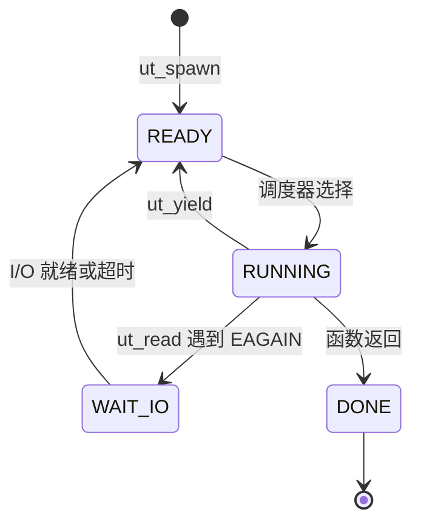

# openEuler 用户级线程调度与 I/O 阻塞行为实验系统

一个可在 openEuler 中构建、运行和复现实验的 C 教学原型：展示协作式用户线程的调度，以及阻塞读、事件驱动等待和 pthread 的行为差异。

**先确认你要看什么：本仓库是用户级线程专题项目；全部 24 项课程作业另有独立实验包。** 课程包的基础任务、拓展验收和开源贡献状态见 [课程实验入口](docs/COURSE_STATUS.md)。

## 分支与当前进度

截至 2026-10-30，GitHub 首页默认显示 `main`。优化代码位于 `perf/runtime-overhead`，仍在 [PR #1](https://github.com/codingsjx/openeuler-uthread-lab/pull/1) 中，尚未合并。克隆默认分支后，不能直接使用优化分支才有的命令或接口。

| 版本 | 已包含的内容 | 从哪里看 |
| --- | --- | --- |
| `main` | 基础运行时、调度/I/O 演示、并发读者和信号测试、pthread 对照、重复实验、离线报告 | 本页以下的快速开始；[第二阶段结果](docs/STAGE2.md) |
| `perf/runtime-overhead` | main 的功能，加上紧凑/按需日志、统计接口、槽位复用、errno 隔离、就绪位图、持久去重等待表 | [优化源码](https://github.com/codingsjx/openeuler-uthread-lab/tree/perf/runtime-overhead)；[优化说明](https://github.com/codingsjx/openeuler-uthread-lab/blob/perf/runtime-overhead/docs/OPTIMIZATION.md) |
| 独立课程实验包 | 24 项基础任务、逐项拓展、课程报告及原始日志 | [课程实验入口与完成状态](docs/COURSE_STATUS.md)；不包含在本仓库的克隆中 |

建议队友先运行最小验收，再读 [设计说明](docs/DESIGN.md)、[接口](include/uthread.h) 和 [核心代码](src/uthread.c)。需要研究最新优化时，再切换优化分支。

## 快速开始

已验证的环境是 openEuler 24.03 LTS-SP3 x86_64、GCC 12.3.1、Python 3.11。优化分支也在 Ubuntu CI 中验证过。实验要求 Linux、glibc 的 ucontext、C11 编译器、make 和 Python 3；C 程序应在 Linux 客户机终端运行，Windows MinGW 不属于验证环境。

```sh
# 仅安装依赖时需要 sudo
sudo dnf install -y git gcc make python3 glibc-devel

git clone https://github.com/codingsjx/openeuler-uthread-lab.git
cd openeuler-uthread-lab
make
make check
```

成功时会看到 C 回归的 `PASS` 输出，以及包含 `"status": "passed"` 的 JSON。脚本校验调度顺序、轨迹完整性和 I/O 等待隔离；任何断言失败或子程序超时都会停止验收。原始输出在 `results/` 中。

运行本项目不需要 root，不需要安装内核模块、eBPF 或容器运行时。这些是独立课程包的实验内容。

## 运行四个演示

在项目根目录执行：

```sh
mkdir -p results
./build/demo schedule first results/first.csv
./build/demo schedule rr results/rr.csv
./build/demo io blocking results/blocking.csv
./build/demo io event results/event.csv
```

| 演示 | 观察什么 | 预期行为 |
| --- | --- | --- |
| `schedule first` | 总是选最低编号 READY 任务 | 用户标记顺序为 `AAAABBBBCCCC` |
| `schedule rr` | 从上次任务后面轮转选取 | 用户标记顺序为 `ABCABCABCABC` |
| `io blocking` | 一个用户任务直接执行阻塞 read | 读结束前，同一承载线程上的工作任务无法推进 |
| `io event` | 非阻塞 read 遇到 EAGAIN 后交给 poll 等待 | 读者等待期间，工作任务仍能推进 |

首次本机冒烟验证中，阻塞版本读结束前的工作步数为 0，事件驱动版本为 40。它只验证该场景的等待隔离，不是性能提升比例。

CSV 格式为 `time_us,tid,event,detail`，使用单调时钟，先记录到内存，结束后导出。`ready/running/wait_io/done` 是用户级运行时状态，不是 Linux 内核调度状态。

## 重复实验与离线报告

```sh
make benchmark
make report
```

`make benchmark` 比较固定工作量下的 `blocking`、`event`、`pthread` 三种方式，包含预热、随机执行顺序、重复测量、同一可用 CPU 的亲和性和工作量校验。它记录总耗时、CPU 时间、读结束前工作步数及轨迹，保存全部正式样本。

可修改实验参数：

```sh
python3 scripts/benchmark.py --repeats 20 --steps 40 --iterations 100000 --delay-ms 100
python3 scripts/make_report.py --output results/my-report.html
```

报告生成器自动选取结果目录中最新且状态为 passed 的 `benchmark.json`；也支持 `--benchmark` 指定具体文件。若本轮测量失败，应先检查本轮 JSON 和日志，避免把自动选中的旧成功结果当成本轮结果。

Windows 上也可下载 ZIP 后直接用浏览器打开已随仓库保存的 `results/report.html`。它内嵌第二阶段的真实样例数据，无需启动服务器，支持场景切换、时间线播放、拖动、缩放和 CSV 下载。GitHub 文件预览不会执行其中的交互代码。

[离线报告截图](docs/stage2-report.png) · [第二阶段实验方法与限制](docs/STAGE2.md)

## 使用优化版

如果已有本地修改，先用 `git status` 确认并保留自己的工作，再切换分支。

```sh
git fetch origin
git switch perf/runtime-overhead
git pull --ff-only
make check

# 原始运行时与当前优化版的同环境对照
make perf-check

# 第一轮优化与第二轮等待表/就绪位图的增量对照
make wait-perf-check
```

这两个 perf 目标仅在优化分支存在。它们分别重编译冻结基线和优化版，核对工作量，保留样本、环境和源码哈希。主比较开启完整记录，无记录模式单独列示。

最新本机数据不是所有场景都更快：2026-10-29 的 openEuler 虚拟机中，第二轮相对第一轮的 31 读者共享管道基准中位数下降 42.35%，但纯调度的一些场景变慢；当前版本相对最初原版的 32 任务完整记录中位数增加约 2.64%。微基准不能替代真实服务的吞吐或尾延迟结论。

| 要核对的结果 | 证据入口 |
| --- | --- |
| 最初原版与第一轮优化，CI 容器数据 | [第一轮说明](https://github.com/codingsjx/openeuler-uthread-lab/blob/perf/runtime-overhead/docs/OPTIMIZATION.md) |
| 第一轮与第二轮增量，CI 容器数据 | [第二轮说明](https://github.com/codingsjx/openeuler-uthread-lab/blob/perf/runtime-overhead/docs/WAIT_OPTIMIZATION.md) |
| 本机 openEuler 的 620 条正式测量，含变慢场景 | [本机复测报告与原始证据](https://github.com/codingsjx/openeuler-uthread-lab/blob/perf/runtime-overhead/docs/VM_VALIDATION_20261029.md) |

容器数据使用 openEuler 用户空间和 runner 宿主内核；本机虚拟机数据使用 openEuler 内核。不同机器、版本或工作量的百分比不能直接叠加。

## 运行时机制与接口

单个内核线程承载多个协作式用户任务，每个任务有独立栈和 ucontext。任务主动 yield 后返回调度器；`ut_read` 等待时登记描述符，由 poll 就绪或超时后恢复。所有 READY 任务耗尽时，调度器才阻塞等待 I/O。



| 通用接口 | 用途与约束 |
| --- | --- |
| `ut_init(policy)` | 初始化一次运行时，选择轮转或 first-ready 策略 |
| `ut_spawn(fn, arg)` | 创建任务；检查返回值是否为负数 |
| `ut_run()` | 运行到任务完成或报错；不能重入 |
| `ut_yield()` | 当前任务主动让出；不会强制抢占其他任务 |
| `ut_read(fd, buf, size, timeout_ms)` | fd 必须预先设置 O_NONBLOCK；超时非负毫秒，-1 表示无截止时间 |
| `ut_mark(label)` / `ut_trace_write(path)` | 记录标记并在运行结束后导出 CSV |
| `ut_destroy()` | 回收运行时资源 |

优化分支额外提供 `ut_init_ex` 和 `ut_get_stats`：可显式关闭记录、读取调度/poll/日志统计；关闭记录时导出返回 ENOTSUP。main 没有这两个接口。

原型采用 128 KiB 固定任务栈，最多 32 个任务；优化版可在批次间复用已完成的槽位。它不提供多核并行、抢占、任意阻塞调用拦截、普通磁盘异步化或栈保护页。长时间不主动让出的任务仍会阻止其他任务推进。ucontext 依赖具体 Linux/libc，当前没有其他架构的实测保证。

## 目录与阅读顺序

| 路径 | 内容 |
| --- | --- |
| [include/uthread.h](include/uthread.h) | 当前分支的接口和约束 |
| [src/uthread.c](src/uthread.c) | 生命周期、上下文、调度、等待、超时和日志 |
| [examples/demo.c](examples/demo.c) | 调度和阻塞/事件驱动演示 |
| [examples/benchmark.c](examples/benchmark.c) | 固定工作量的 blocking/event/pthread 对照 |
| [tests/](tests/) | 运行时和报告数据检查 |
| [scripts/run_experiments.py](scripts/run_experiments.py) | 执行真实程序并校验轨迹 |
| [scripts/benchmark.py](scripts/benchmark.py) | 重复测量和统计 |
| [scripts/make_report.py](scripts/make_report.py) | 从真实数据生成 HTML |
| [docs/DESIGN.md](docs/DESIGN.md) | 机制、状态和设计边界 |
| [docs/FIRST_RUN.md](docs/FIRST_RUN.md)、[docs/STAGE2.md](docs/STAGE2.md) | 首次验证与第二阶段结果 |
| [docs/PROVENANCE.md](docs/PROVENANCE.md) | 课程来源、自主实现与 AI 使用说明 |
| [docs/COURSE_STATUS.md](docs/COURSE_STATUS.md) | 24 项课程包、拓展和本专题的关系 |
| `results/` | 已保留的实测证据，以及本机新生成的结果 |

`results/summary.json` 是冒烟验证，不是统计性能结论；`benchmark-*/benchmark.json` 是重复测量。优化版的 `optimization-*` 与 `wait-optimization-*` 又是另外两套对照。新的结果默认被 .gitignore 忽略，仓库中已有的证据是选择后保留的样本批次。

## 队友如何协作

1. 先复现 `make check`，确认使用的是 main 还是优化分支。
2. 修改调度/等待机制前，结合接口和设计说明阅读代码；做实验时保留命令、参数、环境、JSON 与 CSV。
3. 从要修改的版本创建自己的分支，提交改动后发起 PR。优化版改动以 `perf/runtime-overhead` 为 base；主线说明改动以 `main` 为 base。具备 Write 权限可推送个人分支，否则使用 fork。
4. PR 写清问题、行为变化和实际验证。建议分别承担实现、实验复核、报告解释等工作，分工由队伍自行确定。

提交前至少执行：

```sh
make check
python3 -m unittest discover -s tests -p test_reporting.py -v
```

## 常见问题

| 现象 | 处理方式 |
| --- | --- |
| `make: No rule to make target perf-check` | 当前在 main；切到优化分支后再运行 |
| 找不到 `ucontext.h` 或 glibc 开发文件 | 在 openEuler 中确认 gcc、glibc-devel 已安装 |
| Windows 上验收提示 Linux required | 将源码放进 Linux 虚拟机；Windows 可阅读文档和离线 HTML |
| `ut_read` 返回 EINVAL | 检查调用位置、超时参数，以及 fd 是否为 O_NONBLOCK |
| CSV 导出失败或出现 dropped | 核对日志上限/丢失统计；不要把不完整轨迹当作完整证据 |
| GitHub 中 HTML 只有源码或不能交互 | 下载后用浏览器本地打开 |
| 报告不是本轮数据 | 检查选择的 benchmark.json、状态和时间；可显式传 `--benchmark` |
| 事件驱动冒烟断言偶发失败 | 检查原始轨迹和负载；输入可能因严重调度延迟提前到达，不能删掉失败日志后宣称成功 |
| 找不到 24 项课程脚本 | 当前仓库是专题项目；课程脚本位于独立课程实验包，见课程入口 |

后续工作是增加真实服务负载、长期资源回收检查与教学演示，再整理正式技术报告和视频；已有结果不代表完成了全部竞赛交付。
